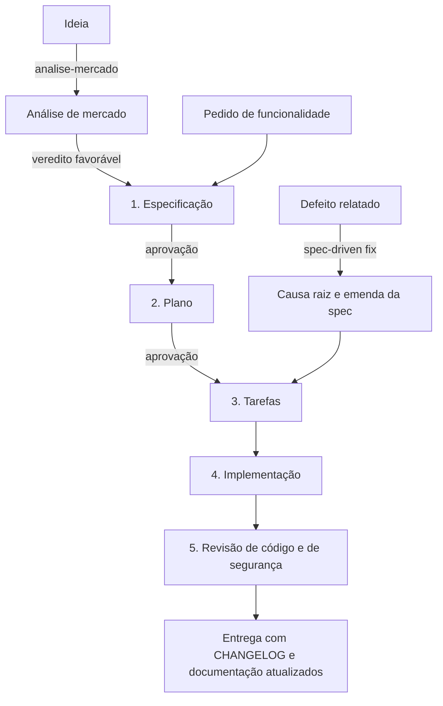
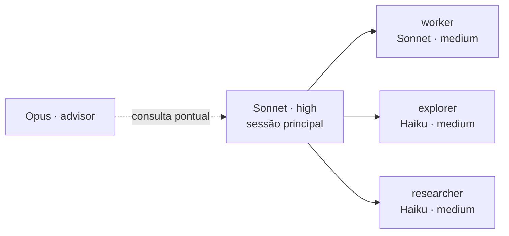

# claude-workflow

Plugin para o [Claude Code](https://code.claude.com) que organiza o desenvolvimento em torno de
três práticas: especificar antes de implementar, revisar código e segurança ao final de toda
mudança, e distribuir o trabalho entre modelos de acordo com o custo de cada tarefa.

Documentação em português. Licença MIT.

## Sumário

1. [Visão geral](#1-visão-geral)
2. [Fluxo de desenvolvimento](#2-fluxo-de-desenvolvimento)
3. [Distribuição de modelos](#3-distribuição-de-modelos)
4. [Componentes](#4-componentes)
5. [Instalação](#5-instalação)
6. [Uso](#6-uso)
7. [Perguntas frequentes](#7-perguntas-frequentes)
8. [Estrutura do repositório](#8-estrutura-do-repositório)

## 1. Visão geral

Assistentes de código tendem a falhar de três formas previsíveis: escrevem código antes que o
problema esteja definido, entregam mudanças sem revisão sistemática e usam o modelo mais caro
para tarefas que não exigem raciocínio. Este plugin endereça cada uma delas.

| Falha | Abordagem |
|---|---|
| Implementação sem definição do problema | Fluxo orientado a especificação (spec, plano, tarefas, implementação), com aprovação explícita após a spec e após o plano |
| Revisão ausente ou opcional | Revisão de código e de segurança obrigatórias ao final de todo fluxo que altera código |
| Custo desproporcional | Sessão principal em Sonnet; leitura e pesquisa delegadas ao Haiku; Opus como consultor em pontos definidos |

## 2. Fluxo de desenvolvimento



Cada fase decide uma classe de questão e não antecipa a seguinte. A especificação descreve
comportamento observável e não menciona tecnologia; o plano define arquitetura, reuso,
invariantes e riscos; as tarefas definem ordem e o comando que verifica cada uma.

As duas aprovações ficam onde corrigir o rumo ainda é barato. A partir do plano aprovado,
tarefas, implementação e revisão seguem sem interrupção, exceto em bloqueio real: credencial
ausente, decisão que cabe ao usuário, ou verificação que grava dados em ambiente compartilhado,
que sempre exige confirmação.

Quando o repositório já possui um processo próprio de especificação (skills `sdd*`,
`specs/constitution.md` ou seção equivalente no `CLAUDE.md`), esse processo prevalece. A
revisão final permanece obrigatória em qualquer caso.

## 3. Distribuição de modelos



A sessão principal planeja, decide e verifica. Subagentes executam trabalho delimitado e
devolvem apenas a conclusão, o que preserva o contexto da sessão principal. O advisor recebe a
sessão inteira a cada chamada e por isso é consultado em três momentos: antes de um plano,
diante de erro recorrente e antes de declarar a tarefa concluída.

Preços de referência por milhão de tokens na API da Anthropic (outubro de 2026):

| Modelo | Entrada | Saída |
|---|---|---|
| Opus 5.5 | US$ 4,00 | US$ 20,00 |
| Sonnet 5.5 | US$ 2,00 | US$ 10,00 |
| Haiku 5.5 | US$ 0,10 | US$ 0,50 |

A economia efetiva depende da carga de trabalho. Sonnet em esforço `high` consome mais tokens
de raciocínio que Opus em `medium`, de modo que a redução na sessão principal é inferior à
diferença de preço. O ganho mais expressivo vem da leitura de código delegada ao Haiku.

<details>
<summary>Quando usar Opus na sessão principal</summary>

<br>

Para trabalho rotineiro, Sonnet em `high` é suficiente. Selecione Opus com `/model opus` no
início da sessão para desenho de arquitetura, investigação de incidente em produção, defeitos
de concorrência ou transação, migrações de banco de alto risco e sessões longas executadas com
autonomia. A troca deve ocorrer no início: o cache de prompt é segmentado por modelo.

</details>

## 4. Componentes

### Skills

| Skill | Finalidade |
|---|---|
| `spec-driven` | Fluxo completo de especificação a revisão. Também atende correção de defeitos (`fix`) e revisão avulsa (`review`). |
| `analise-mercado` | Avalia uma ideia antes da construção: concorrência, preços, tendências, lacunas, demanda e riscos. Produz um veredito e uma especificação inicial. |
| `code-review` | Revisão de correção lógica, design, legibilidade, desempenho e testes. |
| `security-review` | Revisão adversarial de autorização, injeção, segredos, exposição de dados, autenticação, SSRF, upload e criptografia. |
| `migracao` | Planejamento de migração de sistemas legados: inventário, estratégia de corte, migração de dados e rollback. |

<details>
<summary>spec-driven</summary>

<br>

| Fase | Produz | Fora do escopo da fase |
|---|---|---|
| 0. Mapeamento | `docs/` e `CLAUDE.md` do repositório, quando ausentes ou defasados | Remapear o que já está documentado |
| 1. Especificação | `spec.md` com requisitos `RF-nn` e critérios de aceite `CA-nn` | Decisões de implementação |
| 2. Plano | `plan.md` com reuso, invariantes, contratos e riscos | Ordem de execução |
| 3. Tarefas | `tasks.md` com dependências, comando de verificação e rastreabilidade RF → tarefa | Código |
| 4. Implementação | Código e testes | Alteração silenciosa de escopo |
| 5. Revisão | Achados triados e corrigidos, `CHANGELOG.md` | Dispensar qualquer das duas revisões |

Uma tarefa só é marcada como concluída depois que sua verificação executa com sucesso. Correções
de defeito começam pela causa raiz, sem edição de código, e emendam a especificação responsável
pelo comportamento antes da implementação.

</details>

<details>
<summary>analise-mercado</summary>

<br>

A pesquisa é dividida por dimensão (concorrentes, substitutos, lacunas, tendências, demanda e
riscos) e executada em paralelo por subagentes. Toda afirmação factual registra fonte e data de
acesso; estimativas de mercado são identificadas como tal; inferências são separadas dos fatos.
O relatório conclui com um veredito (seguir, reorientar ou descartar) e uma especificação
inicial que serve de documento de origem para o `spec-driven`.

</details>

<details>
<summary>code-review e security-review</summary>

<br>

A revisão de código prioriza poucos achados, cada um justificado e ordenado pelo custo de não
corrigi-lo. A revisão de segurança faz uma triagem ampla do diff e aprofunda apenas nos arquivos
com superfície sensível; cada achado precisa de um cenário de ataque descrito, com atacante,
entrada e resultado.

</details>

### Agentes

| Agente | Modelo | Ferramentas | Atribuição |
|---|---|---|---|
| `worker` | Sonnet, esforço medium | todas | Implementação de uma tarefa já especificada |
| `explorer` | Haiku, esforço medium | somente leitura | Localização de código, usos e convenções |
| `researcher` | Haiku, esforço medium | leitura e web | Documentação, changelogs e APIs de terceiros |

### Configuração global

O diretório `config/` contém o `CLAUDE.md` global, com a política de delegação, e
`settings.example.json`, com a seleção de modelos.

## 5. Instalação

Skills e agentes são instalados como plugin, a partir do Claude Code:

```text
/plugin marketplace add LuizMafraJNR/claude-workflow
/plugin install claude-workflow@claude-workflow
```

O `CLAUDE.md` global e a seleção de modelos não podem ser distribuídos por plugin e são
instalados por script:

```powershell
# Windows
git clone https://github.com/LuizMafraJNR/claude-workflow
powershell -ExecutionPolicy Bypass -File claude-workflow\scripts\install.ps1
```

```bash
# macOS e Linux (requer jq)
git clone https://github.com/LuizMafraJNR/claude-workflow
bash claude-workflow/scripts/install.sh
```

O script não sobrescreve um `CLAUDE.md` existente; nesse caso, grava a versão do plugin como
`CLAUDE.workflow.md` para mesclagem manual. O `settings.json` recebe backup antes da alteração,
e apenas as chaves de modelo são modificadas.

Para confirmar a instalação, abra uma nova sessão e verifique `/model`, `/effort`, `/agents` e
`/skills`.

## 6. Uso

```text
/claude-workflow:analise-mercado sistema de agendamento para barbearias no interior de SC
/claude-workflow:spec-driven exportação do relatório de vendas em CSV
/claude-workflow:spec-driven fix filtro mensal exibe fevereiro em 31/01 após as 21h
/claude-workflow:spec-driven review
```

As skills de plugin recebem o nome do plugin como prefixo, o que evita conflito com skills
homônimas do projeto. Elas também são acionadas automaticamente quando o pedido corresponde à
descrição.

## 7. Perguntas frequentes

<details>
<summary>Alterações pequenas também passam pelo fluxo completo?</summary>

<br>

Não. Quando a implementação é inequívoca, a especificação é dispensada e a dispensa é
informada. A revisão de código e de segurança é mantida. A exceção são correções de
comportamento coberto por uma especificação existente: a especificação é atualizada junto com
o código.

</details>

<details>
<summary>Quais são os requisitos do advisor?</summary>

<br>

O advisor é executado no servidor e requer a API da Anthropic ou um plano que o inclua; não
está disponível via Bedrock, Vertex ou Foundry. Sem ele, os demais componentes funcionam
normalmente. Para desativá-lo, use `/advisor off`.

</details>

<details>
<summary>Qual é o custo de uma análise de mercado?</summary>

<br>

A análise executa buscas na web com até seis subagentes em paralelo, em Haiku. O custo cresce
com o número de fontes consultadas; dimensões irrelevantes para a ideia podem ser omitidas.

</details>

<details>
<summary>É possível adaptar o plugin a um time?</summary>

<br>

Sim. Os modelos de documento ficam em `skills/spec-driven/references/` e a política de
delegação em `config/CLAUDE.md`. Convenções do time devem ser registradas no `CLAUDE.md` do
projeto, que tem precedência sobre as do plugin.

</details>

## 8. Estrutura do repositório

```text
claude-workflow/
├── .claude-plugin/      manifesto do plugin e do marketplace
├── agents/              worker, explorer, researcher
├── config/              CLAUDE.md global e settings.example.json
├── scripts/             install.ps1, install.sh
└── skills/
    ├── spec-driven/
    ├── analise-mercado/
    ├── code-review/
    ├── security-review/
    └── migracao/
```

## Licença

Distribuído sob a licença MIT. Consulte [LICENSE](LICENSE).
