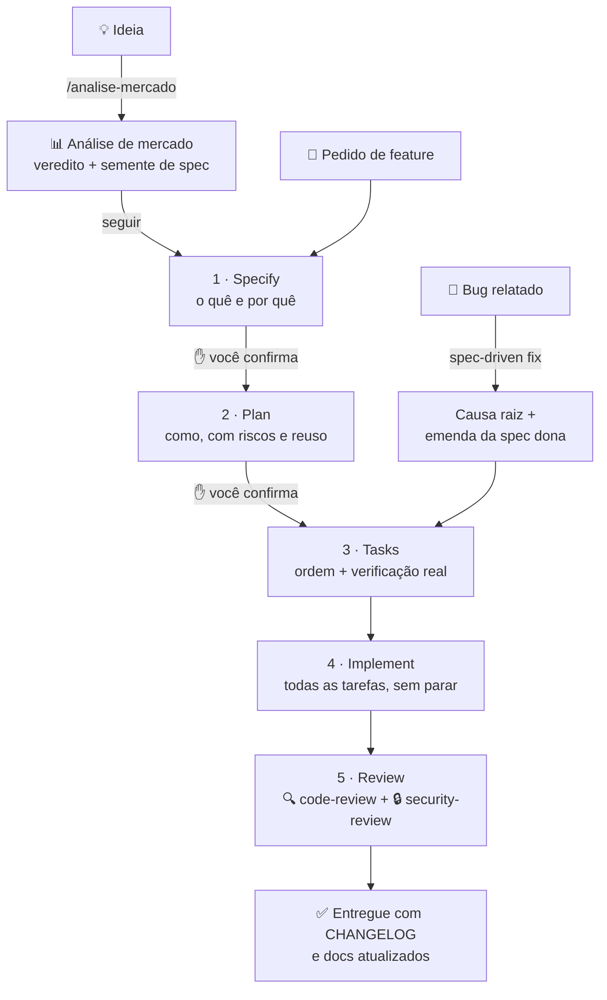
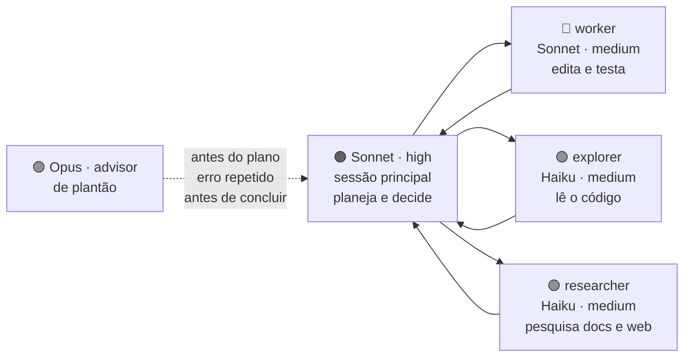

<div align="center">

# 🧭 claude-workflow

**Um workflow de desenvolvimento para o [Claude Code](https://code.claude.com), em português.**

Especificação antes do código · revisão de código e de segurança obrigatórias · trabalho distribuído entre modelos para gastar menos sem perder qualidade.

> *Planeje em high. Delegue em medium. Mantenha o Opus de plantão.*

[Começar](#-instalação-em-3-passos) · [Como funciona](#-como-funciona) · [Skills](#-skills) · [Agentes](#-agentes) · [FAQ](#-perguntas-frequentes)


</div>

---

## 🤔 Por que isso existe

Usar um assistente de código sem método costuma dar em três problemas:

| Problema | O que este workflow faz |
|---|---|
| O código é escrito antes de alguém decidir **o quê** construir | Fluxo **spec-driven**: spec → plano → tarefas → código, com dois pontos de confirmação |
| A mudança sobe sem revisão, ou com revisão "quando der" | **code-review + security-review sempre**, no fim de todo fluxo que escreve código |
| O modelo mais caro faz tudo, inclusive ler arquivo | **Distribuição de modelos**: Sonnet decide, Haiku lê, Opus aconselha só quando importa |

---

## 🗺️ Como funciona



<details>
<summary><b>Por que só dois pontos de confirmação?</b></summary>

<br/>

Corrigir o rumo é barato no fim da **spec** e no fim do **plano**. Depois disso, cada parada só obriga você a aprovar de novo o que já aprovou. Por isso tarefas, implementação e review correm direto até o fim.

O fluxo só para no meio por bloqueio real: uma credencial que falta, uma decisão que é sua, ou uma verificação que **grava dados de verdade** (essa sempre pede permissão).

</details>

<details>
<summary><b>E se meu repositório já tem um processo próprio?</b></summary>

<br/>

O processo local vence. Se o repositório tiver skills `sdd*`, um `specs/constitution.md` ou uma seção de SDD no `CLAUDE.md`, o `spec-driven` segue as regras de lá e vira só referência de método.

O que não muda em nenhum caso: **o fechamento com os dois reviews**.

</details>

---

## 🧠 Distribuição de modelos



<details>
<summary><b>💰 Quanto isso economiza?</b></summary>

<br/>

Preço por milhão de tokens na API (outubro de 2026):

| Modelo | Entrada | Saída | Em relação ao Opus |
|---|---|---|---|
| Opus 5.5 | $4 | $20 | 1× |
| Sonnet 5.5 | $2 | $10 | metade |
| Haiku 5.5 | $0,10 | $0,50 | 40× mais barato |

Onde a economia acontece de verdade:

- **Leitura de código vai para o Haiku.** Ler 50 arquivos consome muito token de entrada, e o Haiku custa quase nada para isso.
- **O contexto da sessão principal não incha.** O subagente lê tudo no contexto dele e devolve só a conclusão.
- **O Opus é chamado poucas vezes.** Cada chamada do advisor envia a sessão inteira, por isso a regra limita a três momentos.

Uma observação honesta: Sonnet em `high` pensa mais que Opus em `medium`, então a economia na sessão principal fica abaixo de 2×. Meça com `npx ccusage@latest daily` antes e depois.

</details>

<details>
<summary><b>🎯 Quando vale trocar para o Opus?</b></summary>

<br/>

Para tarefas de rotina (CRUD, tela, teste, refatoração com escopo definido), Sonnet em `high` dá conta. Troque com `/model opus` no **início** da sessão quando for:

- desenhar a arquitetura de um módulo novo;
- depurar um incidente de produção ou um bug sutil (concorrência, transação);
- escrever uma migração de banco arriscada;
- rodar uma sessão longa e autônoma, em que um erro no começo contamina o resto.

Troque no começo, não no meio: o cache é separado por modelo, e trocar no meio joga o cache fora.

</details>

---

## 🧰 Skills

<details>
<summary><b>📐 <code>spec-driven</code></b>: a especificação é o artefato durável, o código é a saída dela</summary>

<br/>

O fluxo completo, da Fase 0 à 5:

| Fase | Responde | Proibido nesta fase |
|---|---|---|
| 0 · Mapear | O que já existe no repositório? | Re-mapear o que já está documentado |
| 1 · Specify | O quê e por quê | Citar tabela, framework, endpoint |
| 2 · Plan | Como, com reuso, invariantes e riscos | Ordem de execução |
| 3 · Tasks | Em que ordem, e como verificar cada uma | Escrever código |
| 4 · Implement | O código | Mudar o escopo sem avisar |
| 5 · Review | Pode subir? | Pular um dos dois reviews |

**Três formas de chamar:**

```text
/claude-workflow:spec-driven exportar relatório de vendas em CSV
/claude-workflow:spec-driven fix o filtro de mês mostra fevereiro no dia 31/01 à noite
/claude-workflow:spec-driven review
```

**Garantias embutidas:**
- [x] requisitos `RF-01` e critérios `CA-01` numerados, com tabela RF → tarefa
- [x] seção de **reuso** no plano, para não reescrever o que já existe
- [x] toda tarefa com um **comando real** de verificação
- [x] `[x]` só é marcado **depois** de verificar
- [x] parada obrigatória antes de qualquer verificação que **grava dados reais**
- [x] bug corrigido emenda a **spec dona** do comportamento, para a spec não mentir

</details>

<details>
<summary><b>📊 <code>analise-mercado</code></b>: decide <i>se</i> e <i>o quê</i> construir antes de escrever uma linha</summary>

<br/>

```text
/claude-workflow:analise-mercado vale a pena um app de agendamento para barbearias no interior?
```

Pesquisa em paralelo, com um agente `researcher` por dimensão:

| Dimensão | Pergunta |
|---|---|
| Concorrentes diretos | Quem resolve isso, por quanto, para quem? |
| Substitutos | O que as pessoas usam no lugar? |
| Lacunas | Do que os usuários dos concorrentes reclamam? |
| Tendências | O que está crescendo ou encolhendo? |
| Demanda | Existe sinal de que alguém procura isso? |
| Riscos | Regulação, dependência de plataforma, barreira de entrada |

**Regras de evidência:** todo fato tem URL e data, número de mercado é tratado como estimativa, inferência vem marcada, e "não encontrado" é uma resposta válida.

O relatório termina com um **veredito** (seguir, pivotar ou descartar) e uma **semente de spec**, que vira o documento de origem do `spec-driven`.

> Um "não vale a pena" bem fundamentado é um ótimo resultado: economiza meses.

</details>

<details>
<summary><b>🔍 <code>code-review</code></b>: alguém vai conseguir manter isso daqui a seis meses?</summary>

<br/>

Revisa correção lógica, design e SOLID, legibilidade, performance e testes. O formato é **poucos achados, cada um justificado, ordenados pelo custo de ignorar**. Trinta observações irrelevantes escondem o único bug que importa.

</details>

<details>
<summary><b>🔒 <code>security-review</code></b>: o que acontece se eu mentir nesse campo?</summary>

<br/>

Revisão adversarial: autorização e IDOR, injeção, segredos, exposição de dados, autenticação, SSRF, upload e criptografia.

O método é procurar de forma agressiva e afirmar com rigor. Cada achado precisa de um **cenário de ataque descrito**: quem ataca, o que envia e o que obtém. Sem isso, é suspeita, não achado.

</details>

<details>
<summary><b>🚚 <code>migracao</code></b>: trocar de sistema sem virar uma reescrita</summary>

<br/>

Use para migrar de framework, banco, cloud ou arquitetura, ou para aposentar um sistema legado. A skill:

1. levanta o que o sistema atual faz, inclusive o que ninguém documentou;
2. escolhe a estratégia de corte;
3. trata a migração dos dados como um projeto separado;
4. define um rollback concreto.

Cada fase da migração volta para o `spec-driven` como uma feature própria.

</details>

---

## 🤖 Agentes

| Agente | Modelo · effort | Ferramentas | Use para |
|---|---|---|---|
| `worker` | Sonnet · medium | todas | implementar uma parte do trabalho já especificada, com arquivos e verificação definidos |
| `explorer` | Haiku · medium | só leitura | varrer o código: onde está X, quem usa Y, qual a convenção |
| `researcher` | Haiku · medium | leitura + web | documentação, changelog, API de terceiro |

<details>
<summary><b>Regras de delegação</b> (vêm no <code>CLAUDE.md</code> global)</summary>

<br/>

- Se você já sabe em qual arquivo está a informação, leia direto: delegar sai mais caro.
- Tarefas independentes são disparadas **na mesma mensagem**, em paralelo.
- Dois `worker` em paralelo só trabalham em **arquivos diferentes**, ou cada um com `isolation: "worktree"`.
- O relatório de um subagente **não prova** que algo funciona. A sessão principal confere o diff e os testes.

</details>

---

## 🚀 Instalação em 3 passos

**1. Instale as skills e os agentes** (dentro do Claude Code):

```text
/plugin marketplace add LuizMafraJNR/claude-workflow
/plugin install claude-workflow@claude-workflow
```

**2. Instale o `CLAUDE.md` global e a distribuição de modelos.** Um plugin não consegue instalar essas duas coisas, por isso existe o script:

<details>
<summary>🪟 Windows (PowerShell)</summary>

```powershell
git clone https://github.com/LuizMafraJNR/claude-workflow
powershell -ExecutionPolicy Bypass -File claude-workflow\scripts\install.ps1
```

</details>

<details>
<summary>🍎 macOS / 🐧 Linux</summary>

```bash
git clone https://github.com/LuizMafraJNR/claude-workflow
bash claude-workflow/scripts/install.sh   # precisa do jq
```

</details>

O script **nunca sobrescreve** um `CLAUDE.md` que já exista. Ele salva o arquivo do workflow ao lado, como `CLAUDE.workflow.md`, e faz backup do `settings.json` antes de alterar só as chaves de modelo.

**3. Confira** numa sessão nova:

- [ ] `/model` mostra **Sonnet**
- [ ] `/effort` mostra **high**
- [ ] `/agents` lista `worker`, `explorer` e `researcher`
- [ ] `/skills` lista as cinco skills do plugin

---

## ❓ Perguntas frequentes

<details>
<summary><b>Preciso usar o fluxo inteiro para um ajuste pequeno?</b></summary>

<br/>

Não. Se a implementação é óbvia (um typo, CSS, renomear uma variável), o `spec-driven` dispensa a spec e avisa que dispensou. **O código continua passando pelos dois reviews.**

A exceção é corrigir algo que uma spec descreve. Nesse caso a spec é emendada junto com o código, mesmo em correção pequena, para não ficar descrevendo um comportamento que já não existe.

</details>

<details>
<summary><b>O advisor funciona em qualquer plano?</b></summary>

<br/>

O advisor roda no servidor e precisa da API da Anthropic, ou de um plano que o inclua. Ele não funciona via Bedrock, Vertex ou Foundry. Sem o advisor, o resto do workflow funciona normalmente. Para desligar, use `/advisor off`.

</details>

<details>
<summary><b>Por que os nomes aparecem como <code>/claude-workflow:spec-driven</code>?</b></summary>

<br/>

Skills de plugin ganham o nome do plugin como prefixo. Assim elas não colidem com skills do seu projeto que tenham o mesmo nome. As skills também disparam sozinhas quando o pedido combina com a descrição delas, sem você digitar o comando.

</details>

<details>
<summary><b>Quanto custa uma análise de mercado?</b></summary>

<br/>

Ela faz buscas reais na web, com até seis pesquisadores em paralelo. Os pesquisadores rodam em Haiku, que é barato, mas o custo cresce com o número de fontes lidas. Para uma ideia simples, corte as dimensões que não fazem sentido.

</details>

<details>
<summary><b>Posso adaptar para o meu time?</b></summary>

<br/>

Pode, a licença é MIT. Faça um fork, ajuste os templates em `skills/spec-driven/references/` e as regras em `config/CLAUDE.md`. Se o seu time já tem convenções, coloque-as no `CLAUDE.md` do projeto: elas valem mais que as do workflow.

</details>

---

## 📁 Estrutura

```text
claude-workflow/
├── .claude-plugin/        manifesto do plugin e do marketplace
├── skills/
│   ├── spec-driven/       SDD + correção + review (references/)
│   ├── analise-mercado/   ideação e mercado (references/relatorio.md)
│   ├── code-review/
│   ├── security-review/
│   └── migracao/
├── agents/                worker · explorer · researcher
├── config/                CLAUDE.md global e settings.example.json
└── scripts/               install.ps1 · install.sh
```

---

<div align="center">

Licença MIT · feito para o [Claude Code](https://code.claude.com)

</div>
